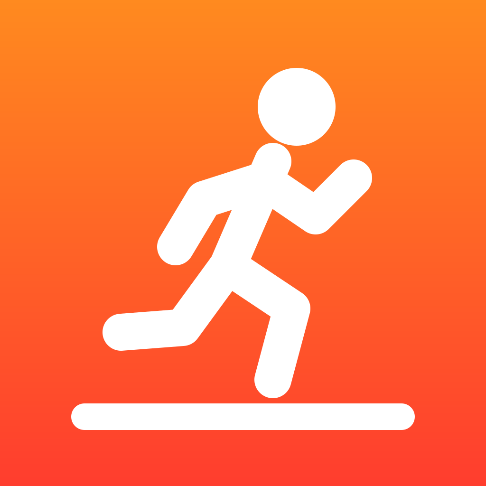

# Cinta



App de iPhone para controlar una cinta de correr NordicTrack T Series 5 (NTL17624-INT) por Bluetooth. Sin la app de iFit, sin suscripción.

## Qué hace

- Conecta sola con la cinta y se reconecta si se corta el Bluetooth.
- Pantalla: tiempo transcurrido en grande (con reset), velocidad y altura reales.
- Botones de velocidad: 0, −, +, 4, 5, 9 y 10. Los saltos son de 0,5 km/h.
- Botones de altura: 0, −, 1 y +. Los saltos son de 1 %.
- Series: bloques de pasos (duración, velocidad y altura) que se repiten. Por ejemplo 5 min andando, 8 × (1 min corriendo + 1 min andando), 5 min andando. Pita 3 segundos antes de cada cambio.
- Vertical y apaisada. La pantalla no se apaga mientras está abierta.

La llave magnética y el STOP de la cinta siguen funcionando igual. Si paras desde la consola, la serie se pone en pausa. Tras un corte, la app nunca arranca la cinta si está parada.

## Compilar

Hace falta [XcodeGen](https://github.com/yonaskolb/XcodeGen):

```
xcodegen
open Cinta.xcodeproj
```

Cambia `DEVELOPMENT_TEAM` en `project.yml` por tu equipo.

## Protocolo

La cinta usa el protocolo iFit por Bluetooth (servicio `00001533-1412-efde-1523-785feabcd123`). Las tramas de inicio, sondeo, velocidad, inclinación y arranque salen de [QZ (qdomyos-zwift)](https://github.com/cagnulein/qdomyos-zwift), variante `nordictrack_tseries5_treadmill`. Están en `Cinta/IFitProtocol.swift`.

Si la cinta tiene FTMS en vez de iFit, la app usa FTMS.

Otras cintas NordicTrack y ProForm con iFit por Bluetooth usan el mismo servicio pero otras tramas. En QZ están todas.

## Mando físico

En `docs/mando-fisico.svg` hay un boceto de un mando con ESP32, pantalla y botones arcade. Todavía no está hecho.
